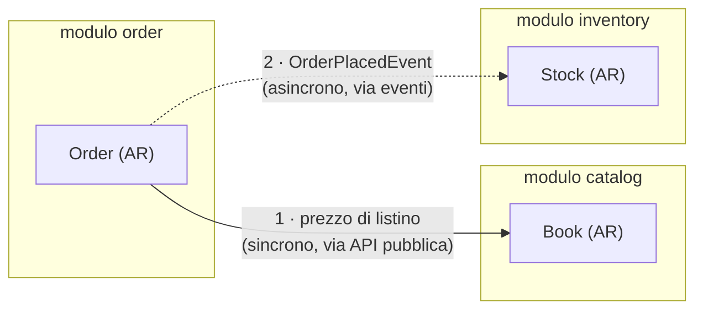

# BookStore Online — Modular Monolith con DDD e Spring Modulith

**Corso:** Architetture Software Avanzate — A.A. 2026/2027
**Laboratorio 4:** Domain-Driven Design e Modular Monoliths in Java
**Stack:** Java 21 · Spring Boot 4.1.1 · Spring Modulith 2.1.1 · Gradle (Kotlin DSL) · PostgreSQL

> **Nota sul documento.** Questo README è una rielaborazione della consegna: stesso contenuto
> normativo, riorganizzato, con la terminologia resa uniforme e con l'aggiunta di un percorso di
> lavoro incrementale. Il testo originale del docente è conservato verbatim in
> [`docs/consegna-originale.md`](docs/consegna-originale.md) — **in caso di dubbio fa fede quello**.
> Le differenze sono elencate in fondo, in [Scostamenti dalla consegna](#scostamenti-dalla-consegna).

---

## Indice

**Parte I — Cosa va costruito**
[1. Obiettivi](#1-obiettivi) · [2. Il dominio](#2-il-dominio-bookstore-online) · [3. Le regole architetturali](#3-le-regole-architetturali-r1r9) · [4. Il modello di dominio](#4-il-modello-di-dominio) · [5. I task](#5-i-task) · [6. Come viene valutato](#6-come-viene-valutato) · [7. Setup tecnico](#7-setup-tecnico)

**Parte II — Come ci arrivo**
[Patto di lavoro](#patto-di-lavoro) · [Percorso a step](#percorso-a-step) · [Strategia di test](#strategia-di-test) · [Stato attuale del codice](#stato-attuale-del-codice) · [Diario delle decisioni](#diario-delle-decisioni) · [Glossario](#glossario-operativo) · [Scostamenti](#scostamenti-dalla-consegna)

---

# PARTE I — COSA VA COSTRUITO

## 1. Obiettivi

Progettare e implementare il backend di un e-commerce come **Modular Monolith**: una sola
applicazione Spring Boot, un solo processo, un solo database — ma con confini interni **espliciti e
verificati automaticamente**, al punto che i moduli potrebbero essere estratti in servizi separati
senza riscrivere il dominio.

Due famiglie di pattern DDD sono in gioco:

* **Strategici** — dove passano i confini, chi parla con chi e in che forma (*Bounded Context*,
  *Ubiquitous Language*, integrazione tra contesti).
* **Tattici** — come è fatto il codice dentro un confine (*Aggregate*, *Entity*, *Value Object*,
  *Domain Event*, *Repository*, *Application Service*).

Il laboratorio valuta soprattutto i primi, ma li verifica attraverso i secondi: un confine si rompe
quasi sempre perché un pattern tattico è stato applicato male (un repository esposto, un'entità che
viaggia in un evento, una regola di business finita in un service).

## 2. Il dominio: "BookStore Online"

Un e-commerce semplificato per la vendita di libri. Dalle sessioni di *Event Storming* con gli
esperti di dominio sono emersi tre **Bounded Context**, che diventeranno i tre moduli di vertice:

| Modulo | Responsabilità | Aggregate Root | Tipo di sottodominio |
|---|---|---|---|
| **`order`** | Il ciclo di vita dell'ordine: creazione, pagamento, spedizione | `Order` | **Core Domain** — qui sta la complessità di business |
| **`inventory`** | Il magazzino: quante copie fisiche ci sono, e scalarle quando si vende | `Stock` | Supporting — una sola invariante, ma critica |
| **`catalog`** | La vetrina: quali libri esistono e a che prezzo sono offerti | `Book` | Supporting — sostanzialmente CRUD |

L'ultima colonna non è decorativa: determina **dove investire sforzo di modellazione** e, di
conseguenza, l'ordine in cui conviene costruire
(vedi [Perché questo ordine](#perché-questo-ordine-e-non-catalog-per-primo)).

### Il flusso principale



*(se il diagramma non si vede: `order` interroga `catalog` in modo **sincrono** attraverso un'API
pubblica per conoscere il prezzo; poi notifica `inventory` in modo **asincrono** pubblicando
`OrderPlacedEvent`. Nessuna freccia va mai nella direzione opposta.)*

1. Il cliente effettua un checkout → `order` costruisce l'aggregato `Order`.
2. `order` ha bisogno del prezzo corrente: lo chiede a `catalog` **attraverso la sua API pubblica**,
   mai attraverso il suo repository.
3. L'ordine viene salvato e pubblica `OrderPlacedEvent`.
4. `inventory` reagisce all'evento **in modo asincrono** e scala le giacenze.
5. Se le copie non bastano, solleva `OutOfStockDomainException`.

### Ubiquitous Language: la stessa parola, significati diversi

Questo è il cuore del concetto di Bounded Context, e la ragione per cui i moduli esistono:

| Parola | In `catalog` significa… | In `inventory` significa… | In `order` significa… |
|---|---|---|---|
| **Libro** | un'offerta commerciale: titolo, autore, ISBN, prezzo di listino | una giacenza: quante copie fisiche su uno scaffale | una riga d'ordine: un `bookId` e un prezzo congelato |
| **Prezzo** | prezzo di listino, cambia nel tempo | non esiste il concetto | `unitPrice`, immutabile dal momento dell'acquisto |
| **Disponibile** | "pubblicato in vetrina" | "ci sono copie in magazzino" | non esiste il concetto |

Due definizioni diverse di "libro" non vanno riconciliate in una classe unica: è precisamente
questa tentazione che il modular monolith deve impedire. I contesti comunicano per **identificatore**
(`bookId`), non per oggetto condiviso.

## 3. Le regole architetturali (R1–R9)

Vincoli non negoziabili. Sono numerati per poterli citare nei commit, nel diario e nelle review.

### Isolamento dei moduli

* **R1** — Una sola applicazione Spring Boot. I moduli sono **package di primo livello** sotto
  `com.example.bookstore`: `catalog`, `inventory`, `order`.
* **R2** *(regola aurea)* — **Vietato** iniettare il `Repository` o le entità di dominio di un modulo
  dentro un altro modulo. Se lo fai, il laboratorio è fallito nel suo punto centrale.
* **R3** — Le chiamate inter-modulo **sincrone**, quando servono, passano **esclusivamente** per
  un'interfaccia pubblica esposta dal modulo chiamato. Tutto il resto del modulo è interno.
* **R4** — La comunicazione inter-modulo **principale** è **asincrona, a eventi** (Domain Events).
  Il sincrono è l'eccezione da motivare, non la norma.
* **R5** — Nessuna dipendenza ciclica tra moduli. Il test architetturale deve dimostrarlo.

### Pattern tattici

* **R6** — **Value Object**: immutabili, come `record` Java 21 (`Money`, `Address`, gli
  identificatori). Validano sé stessi alla costruzione.
* **R7** — **Niente modelli anemici**. Un Aggregate Root senza comportamento — solo campi, getter e
  setter — è l'anti-pattern che questo laboratorio punisce. Le invarianti stanno dentro l'aggregato,
  non nei service: `order.addOrderItem(...)` ricalcola il totale **da sé**.
* **R8** — **Domain Event**: `record` immutabile, nome che descrive un **fatto passato**
  (`OrderPlacedEvent`, non `PlaceOrderCommand`), pubblicato **dall'aggregato**, con dentro il
  **minimo** necessario al consumatore.
* **R9** — Niente infrastruttura dentro il dominio: nessun `@RestController`, nessuna query SQL,
  nessun accesso diretto al database nelle classi di dominio. Separazione in stile *Ports & Adapters*
  (o Onion) preferibile.

## 4. Il modello di dominio

Modelli volutamente minimi: il focus è sull'architettura, non sul numero di campi. **Aggiungere
campi non porta punti; aggiungere comportamento sì.**

> **Regola trasversale:** le relazioni **tra moduli diversi** passano solo per identificatore
> (`UUID bookId`). Mai `private Book book` dentro `OrderItem`. Mai.

### 4.1 Value Object condivisi

```java
public record Money(BigDecimal amount, String currency) {
    // validazione nel compact constructor (es. amount >= 0, currency non nulla)
    // …e i metodi per usarlo davvero: add, multiply, …
}

public record Address(String street, String city, String zipCode, String country) { }
```

> **Decisione da prendere (Step 2):** package `common` condiviso **oppure** una copia per modulo?
> Il primo evita duplicazione ma introduce una dipendenza comune che tende a diventare una
> discarica; il secondo è più fedele al DDD ("stesso nome, contesti diversi"). Scegli e motiva.

### 4.2 Modulo `order`

Il modulo più ricco. `Order` è l'Aggregate Root e governa il ciclo di vita di `OrderItem`.

**`Order`** *(Aggregate Root)*

| Campo | Tipo | Note |
|---|---|---|
| `id` | `UUID` | identità dell'ordine |
| `customerId` | `String` | semplificato a stringa per l'esercizio |
| `shippingAddress` | `Address` | Value Object |
| `status` | `OrderStatus` | `CREATED`, `PAID`, `SHIPPED`, `CANCELLED` |
| `items` | `List<OrderItem>` | entità figlie, non accessibili dall'esterno |
| `totalPrice` | `Money` | ricalcolato dall'aggregato |

**`OrderItem`** *(entità locale dell'aggregato — non è un Aggregate Root)*

| Campo | Tipo | Note |
|---|---|---|
| `id` | `UUID` | identità della riga |
| `bookId` | `UUID` | **riferimento per ID** al libro di `catalog` |
| `quantity` | `int` | |
| `unitPrice` | `Money` | prezzo **congelato** all'acquisto |

**Vincoli:** `Order` **non** espone `setItems()` né `setTotalPrice()`. Espone
`addOrderItem(UUID bookId, int quantity, Money price)`, che aggiunge la riga **e** ricalcola
`totalPrice`. Lo stato dell'ordine è governato da metodi di dominio, non da un setter.

### 4.3 Modulo `inventory`

**`Stock`** *(Aggregate Root)*: `UUID id`, `UUID bookId`, `int quantity`.

**Vincoli:** espone `public void decrease(int amount)`. Il metodo verifica l'invariante: se
`amount > quantity`, solleva `OutOfStockDomainException`. **Nessun `setQuantity()`.**

### 4.4 Modulo `catalog`

**`Book`** *(Aggregate Root)*: `UUID id`, `String title`, `String author`, `Money price`.
*(l'id potrebbe essere derivato dall'ISBN — scelta tua, da motivare.)*

### 4.5 Domain Events

```java
public record OrderPlacedEvent(UUID orderId, List<OrderLine> lines) {
    public record OrderLine(UUID bookId, int quantity) { }
}
```

Nota cosa **non** c'è dentro: niente `Order`, niente `Money`, niente indirizzo. L'inventario deve
sapere solo quali libri e quante copie. Il payload di un evento è un contratto pubblico: più ci
metti dentro, più accoppi i moduli.

> **Domanda non banale (Step 4):** in quale package vive `OrderPlacedEvent`? Se sta in un package
> interno di `order`, `inventory` per ascoltarlo dovrebbe importarlo — violando R3. La risposta ha a
> che fare con il concetto di *named interface* di Spring Modulith.

## 5. I task

### T1 — Modellare il dominio di `order`

1. Aggregate Root `Order` + entità locale `OrderItem`.
2. Value Object `Money` e `Address`.
3. Application Service `OrderManagementService` con il metodo `placeOrder(CheckoutRequest request)`.
4. Dentro `placeOrder`: creare l'ordine e pubblicare `OrderPlacedEvent` con l'id dell'ordine e le
   righe. **Nessun controller REST e nessun accesso diretto al database dentro il dominio** (R9).

### T2 — Far comunicare i moduli a eventi

1. In `inventory`, un componente (es. `InventoryEventListener`) annotato con
   **`@ApplicationModuleListener`** che reagisce a `OrderPlacedEvent`.
2. Alla ricezione: recuperare lo `Stock` di ogni libro dell'ordine e invocare `decrease(quantity)`.
3. Con giacenza insufficiente: sollevare `OutOfStockDomainException`.

> **Limite noto, e va saputo discutere.** Il listener gira in una transazione separata da quella che
> ha creato l'ordine: se fallisce, l'ordine resta creato. In un sistema reale servirebbe una **saga
> compensativa** (es. un `OrderCancelledEvent` che riporta indietro lo stato). Implementarla è fuori
> scope; **capire perché servirebbe è dentro scope** ed è una domanda da esame.

### T3 — Verificare l'architettura automaticamente

Una classe di test (es. `ModularityTests`) che istanzia l'architettura e la verifica:

```java
ApplicationModules modules = ApplicationModules.of(BookStoreApplication.class);
modules.verify();
```

`verify()` fa fallire la build in presenza di cicli o accessi a package interni di altri moduli.
Deve girare dentro `./gradlew build`, non a mano.

### T4 — Generare la documentazione dell'architettura

Con `spring-modulith-docs`, nello stesso test:

```java
new Documenter(modules)
    .writeModulesAsPlantUml()
    .writeIndividualModulesAsPlantUml();
```

I diagrammi a componenti C4 finiscono in **`build/spring-modulith-docs`** (`target/…` nella consegna,
che assume Maven). La dipendenza **non è ancora nel progetto**: va aggiunta.

### T5 — Modulo `catalog` e integrazione sincrona *(derivato da R3)*

> La consegna elenca `catalog` tra i Bounded Context e ne specifica l'aggregato nell'Allegato A, ma
> non le dedica un task. Senza di esso R3 ("le chiamate sincrone passano per un'API pubblica") non
> viene mai esercitata, e `unitPrice` arriverebbe dal client — cioè da una fonte di cui il dominio
> non si può fidare. Quindi: **task aggiunto**, da concordare col docente se vuoi tenerlo minimale.

1. Aggregate Root `Book` con il suo repository, **interni** al modulo.
2. Un'interfaccia pubblica di modulo (es. `CatalogApi` / `BookPriceProvider`) che esponga il minimo
   necessario a `order` — e **nient'altro**.
3. `order` usa quell'interfaccia per ottenere `unitPrice`, senza mai vedere `Book` né il suo
   repository.

## 6. Come viene valutato

| Criterio | Cosa viene guardato | Dove si gioca |
|---|---|---|
| **Rispetto dei confini** | nessun ciclo, nessun "leak" di concetti tra `order` e `inventory` | R2, R3, R5 · Step 1, 6, 7 |
| **Ricchezza del dominio** | assenza di modelli anemici; l'aggregato protegge le proprie invarianti; `record` usati bene per i VO *(plus)* | R6, R7 · Step 2 |
| **Uso corretto degli eventi** | `@ApplicationModuleListener` reale, non una chiamata diretta mascherata | R4, R8 · Step 4, 6 |
| **Test architetturale** | `modules.verify()` **verde** | R5 · Step 1, 8 |

Il primo e il secondo criterio si perdono in modo subdolo: `verify()` può essere verde con un
dominio completamente anemico. Il test architetturale è necessario, non sufficiente.

## 7. Setup tecnico

Il progetto è già inizializzato. Rispetto alla consegna — che assume Maven — qui si usa **Gradle
Kotlin DSL**:

| Consegna (Maven) | Qui (Gradle) |
|---|---|
| `pom.xml` | `build.gradle.kts` |
| `<dependencyManagement>` + BOM | `dependencyManagement { imports { mavenBom(…) } }` |
| output in `target/` | output in `build/` |
| `target/spring-modulith-docs` | `build/spring-modulith-docs` |
| `mvn test` | `./gradlew test` |

**Già presente:** `spring-modulith-starter-core`, `spring-modulith-starter-jpa`,
`spring-modulith-starter-test`, Spring Data JPA, Spring Web MVC, PostgreSQL, Docker Compose support.
**Da aggiungere:** `spring-modulith-docs` (T4 / Step 9).

```bash
./gradlew build                            # compila + test (include verify architetturale)
./gradlew test --tests '*Modularity*'      # solo il test di architettura
./gradlew bootRun                          # avvia l'app (solleva Postgres via compose.yaml)
ls build/spring-modulith-docs              # dopo lo Step 9
```

---

# PARTE II — COME CI ARRIVO

## Patto di lavoro

L'obiettivo è imparare a progettare, non a copiare. Quindi, esplicitamente:

* L'assistente **non scrive il codice di dominio** al mio posto e **non anticipa la soluzione** di
  uno step che non ho ancora provato.
* Quando sono bloccato chiedo **un indizio alla volta**, in scala:
  **(1)** domanda socratica → **(2)** il nome del pattern o della feature da studiare →
  **(3)** pseudo-struttura → **(4)** codice. Non salto a (4).
* A fine step chiedo una **review contro la checklist dello step**, non un rewrite.
* Libero accesso dell'assistente a: build file, configurazione, documentazione, scaffolding non
  concettuale. **Il dominio è mio.**

**Ritmo:** uno step alla volta, un commit per step (`step-3: application service placeOrder`). Non
passo oltre finché la checklist non è verde. Gli step sono ordinati in modo che ognuno renda
visibile un errore di progettazione dello step precedente: anche quelli che sembrano banali vanno
fatti.

Legenda: 🎯 **obiettivo** · ❓ **domande a cui devo saper rispondere** · ✅ **fatto quando** ·
⚠️ **trappole**

## Perché questo ordine (e non `catalog` per primo)

L'istinto dice di partire da `catalog`: è il modulo indipendente, la foglia dell'albero delle
dipendenze. È l'ordine giusto per *compilare* un sistema, ma è quello sbagliato per **impararlo**.

**`order` è il Core Domain; `catalog` è un supporting subdomain.** `Book` ha quattro campi e nessuna
invariante: non esiste una regola di business che possa violare. `Order` invece ha tutto ciò che
questo laboratorio valuta — aggregato con entità figlie, ricalcolo del totale, transizioni di stato,
eventi di dominio. Il DDD strategico dice di concentrare lo sforzo di modellazione dove sta la
complessità di business, non di spalmarlo in modo uniforme.

Da qui tre conseguenze pratiche:

* **Partire da `catalog` insegna la lezione sbagliata.** `Book` + `BookRepository` + un service CRUD
  è un modulo che compila e dà la sensazione di aver fatto progresso — ma è, alla lettera, un
  modello anemico, perché non ha invarianti da proteggere. Se è il primo codice che scrivo, il
  pattern che mi resta in testa è "aggregate root = campi + repository": l'opposto di R7. Poi lo
  replico in `order`, dove è un errore vero.
* **La dipendenza `order → catalog` non esiste finché non la creo io.** Negli Step 2–5 `order` non
  tocca mai `catalog`: il prezzo arriva dalla `CheckoutRequest` e va benissimo. La dipendenza
  compare allo Step 7, che *è* l'esercizio sull'integrazione tra contesti. `order` è costruibile in
  isolamento esattamente quanto `catalog`.
* **Costruire `order` senza `catalog` è un vincolo utile.** Mi obbliga a riferirmi al libro con un
  `UUID` nudo — che è precisamente la regola "tra moduli solo identificatori", ottenuta gratis. Se
  `catalog` esistesse già, con il suo `BookRepository` a portata di `@Autowired`, la tentazione di
  iniettarlo sarebbe massima; ed è la violazione che pesa di più nella valutazione (R2).

Resta vero che prendere confidenza con l'impianto Modulith su un modulo banale sarebbe comodo — ma
quello lo copre lo **Step 1**, che fa girare il test architetturale sui tre moduli **vuoti**:
l'impianto si impara lì, a costo zero, senza dover scrivere un aggregato anemico per farlo.

## Percorso a step

### Step 0 — Terreno solido

🎯 Build verde e applicazione che parte, **prima** di scrivere dominio. Non si impara niente con
dodici errori di compilazione contemporaneamente.

❓
* Il progetto compila oggi? *(no: c'è codice incompleto in `order`)*
* Serve davvero Postgres adesso, o parto con H2 in memoria e rimando l'infrastruttura?
* Cosa fa `spring-boot-docker-compose` quando lancio l'app?

✅ `./gradlew build` verde · `./gradlew bootRun` avvia il contesto senza eccezioni · primo commit.
È **lecito cancellare l'abbozzo** esistente e ripartire pulito.

⚠️ Non accumulare "codice che intanto scrivo e poi sistemo". Qui il valore sta nelle decisioni, non
nelle righe.

---

### Step 1 — I confini prima del codice → *R1, R5, T3*

🎯 Dichiarare i tre moduli e far girare il test architetturale **quando sono ancora vuoti**. Il test
di architettura è il primo test da avere, non l'ultimo.

❓
* Cosa rende un package un *application module* per Spring Modulith? Serve `package-info.java`? Cosa
  fa `@ApplicationModule`?
* Qual è la differenza tra i package **API** di un modulo e quelli **interni**? Chi vede cosa, e
  come lo decide Modulith di default?
* Se scrivo il test ora che non c'è niente, passa banalmente. A che serve? *(a farlo fallire **il
  giorno in cui sbaglio**, non tre settimane dopo)*

✅ Esistono `com.example.bookstore.{catalog,inventory,order}` con il loro `package-info.java` ·
`ModularityTests` esiste e `modules.verify()` passa · so stampare la struttura dei moduli e leggere
l'output (`ApplicationModules` è `Iterable`).

⚠️ Non creare ancora sotto-package `domain` / `application` / `infrastructure` "perché si fa così".
Introducili quando ti servono davvero (Step 5): devi **sentire** il problema prima di applicare la
soluzione.

---

### Step 2 — Il dominio di `order`, senza framework → *R6, R7, T1*

🎯 Modellare `Order`, `OrderItem` e i Value Object in **Java puro**: niente `@Entity`, niente Spring,
niente repository. Solo invarianti.

❓
* Quali sono le invarianti di un ordine? Un ordine senza righe può essere piazzato? Si può aggiungere
  una riga a un ordine `SHIPPED`? Due righe sullo stesso libro si sommano o restano separate? Il
  totale può divergere dalla somma delle righe?
* `OrderItem` è Entity o Value Object? Ha senso che abbia un `id` proprio? Il criterio: **due righe
  con gli stessi valori sono "la stessa riga"?**
* Chi può creare un `Order`? Un costruttore pubblico vuoto più setter, o una factory che riceve già
  tutto ciò che rende l'ordine valido?
* `Money`: cosa succede se sommo 10 EUR e 10 USD? Cosa **dovrebbe** succedere? Il mio `Money` ha
  `add`/`multiply` per essere usato, o è solo un contenitore di dati?
* Il totale è un campo memorizzato o un metodo calcolato? Pro e contro in un sistema reale (prezzi
  che cambiano, sconti, storicizzazione)?

✅ `Order` non ha `setItems()` / `setTotalPrice()` né un costruttore vuoto usabile dall'esterno ·
`order.items()` restituisce qualcosa che il chiamante **non può modificare** (e so spiegare perché
restituire la `List` interna è una falla) · esistono test JUnit **puri** (zero `@SpringBootTest`,
millisecondi) che coprono ricalcolo del totale, rifiuto di quantità non valide e rifiuto di una
transizione di stato illegale · un test prova che **non riesco** a rompere l'aggregato dall'esterno.

⚠️ Se per testare una regola di business devo avviare Spring, la regola è nel posto sbagliato.

---

### Step 3 — Application Service e confine del caso d'uso → *R9, T1*

🎯 `OrderManagementService.placeOrder(CheckoutRequest request)`, e capire **cosa ci va dentro e cosa
no**.

❓
* Differenza tra *domain service* e *application service*: quale sto scrivendo?
* `CheckoutRequest` è dominio o DTO di input? Da dove arriva? Può contenere `Money`/`Address` o
  devono essere tipi semplici tradotti al confine?
* Quante righe dovrebbe avere `placeOrder`? Se contiene `if` di business, dove dovrebbero stare?
* Dove metto `@Transactional` e perché? Qual è l'unità di consistenza? *(indizio: coincide con
  l'aggregato)*
* Chi assegna l'`OrderId`: database, servizio o aggregato? Cosa cambia per i test e per gli eventi?

✅ `placeOrder` **orchestra** (costruisce → delega all'aggregato → salva) e non contiene regole di
business · la classe si chiama `OrderManagementService` *(occhio al refuso attuale:
`OrderManagment`)* · un test chiama `placeOrder` direttamente — se devo passare da un controller
REST, ho sbagliato confine.

⚠️ Il metodo si chiama `placeOrder`, non `addOrderItem`. `addOrderItem` è un metodo
**dell'aggregato**: il servizio non deve ripubblicare al mondo le operazioni interne dell'aggregato.

---

### Step 4 — Domain Events → *R4, R8, T1*

🎯 Pubblicare `OrderPlacedEvent`. È il cuore della valutazione: l'evento **è** il contratto tra i
moduli.

❓
* Il nome descrive un fatto passato? (`OrderPlaced`, non `PlaceOrder`)
* R8 dice che l'evento è pubblicato **dall'aggregato**: come fa un oggetto di dominio, che non
  conosce Spring, a pubblicare un evento? *(studia `AbstractAggregateRoot`, `@DomainEvents`,
  `@AfterDomainEventPublication`; valuta anche l'alternativa "l'aggregato accumula, il servizio
  pubblica")*
* Quando viene **effettivamente** spedito l'evento: al `registerEvent()`, al `save()`, o al commit?
  Perché la risposta conta?
* **Dove vive il record `OrderPlacedEvent`?** Se sta in un package interno di `order`, `inventory`
  deve importarlo → violazione di R3. Cosa prevede Modulith per i tipi destinati a uscire dal
  modulo? *(named interfaces)*
* Cosa ci metto dentro: l'intero `Order`? I `Money`? Solo `bookId` + `quantity`? Qual è il criterio?

✅ Evento `record` immutabile, nome al passato · un test verifica che piazzando un ordine l'evento
viene pubblicato *(Modulith offre `PublishedEvents` e l'API `Scenario`)* · so spiegare perché
l'evento **non** contiene l'entità `Order`.

⚠️ Se `inventory` importa `com.example.bookstore.order.domain.Order` o il suo repository, è persa la voce
più pesante della valutazione.

---

### Step 5 — Persistenza: dominio contro mapping → *R7, R9*

🎯 Rendere `Order` persistibile **senza che JPA detti la forma del dominio**. È lo step dove emergono
le tensioni vere.

❓
* I `record` funzionano come `@Embeddable`? E come `@EmbeddedId`? **Provalo presto.** Se il tuo stack
  non lo consente nativamente, quali sono le opzioni? *(istanziatori custom, classi immutabili
  non-record, oppure **due modelli separati**: dominio puro + entità di persistenza con un mapper)*
* JPA vuole un costruttore senza argomenti e accesso ai campi. Quanto è disposto a cedere il mio
  dominio prima di diventare anemico? Dove traccio la linea?
* **`OrderItemRepository` ha ragione di esistere?** Un repository per **Aggregate Root**, non per
  ogni entità. Se `OrderItem` vive solo dentro `Order`, chi lo salva? *(`cascade`, `orphanRemoval`)*
* Il repository è un'interfaccia **del dominio** o un dettaglio infrastrutturale? Se volessi
  invertire la dipendenza (Ports & Adapters), dove metterei interfaccia e implementazione?
* `List<OrderItem>` senza annotazione di relazione: cosa ne fa Hibernate? Serve `@OneToMany`?
  L'ordine delle righe conta?
* Il repository deve essere visibile fuori dal modulo? Chi, fuori da `order`, ha motivo di vederlo?

✅ Il contesto parte e lo schema viene creato *(`ddl-auto` in dev — ma so che in produzione servirebbe
una migrazione versionata)* · un test di integrazione salva e ricarica un `Order` **con righe e
totale corretti** · non esistono repository per entità non-root, o so motivare perché ne tengo uno ·
**i test di dominio dello Step 2 girano ancora senza Spring**.

⚠️ Se per aggiungere una riga devo chiamare `OrderItemRepository.save()`, l'aggregato non governa più
il proprio ciclo di vita.

---

### Step 6 — `inventory` reagisce → *R2, R4, T2*

🎯 Chiudere il ciclo — ordine piazzato, stock scalato — **senza una sola chiamata diretta tra
moduli**.

❓
* `Stock` è un aggregato: quali invarianti protegge? Cosa deve rifiutare `decrease(int)`?
* `OutOfStockDomainException`: package di dominio o applicativo? Checked o unchecked? Perché?
* Differenza tra `@EventListener`, `@TransactionalEventListener` e `@ApplicationModuleListener`: cosa
  aggiunge il terzo? *(indizio: asincronia + transazione nuova + event publication registry)*
* Con `spring-modulith-starter-jpa` nel build, quale **tabella** compare nel database? Cosa ci
  finisce dentro, quando viene svuotata, cosa succede se il listener fallisce?
* Se il listener riceve lo stesso evento due volte (retry, riavvio), il codice è **idempotente**? Se
  no, che fine fanno le giacenze?
* Il listener gira in un'altra transazione: l'eccezione di stock può annullare l'ordine? *(no, non
  automaticamente → è esattamente il motivo della saga compensativa di T2)*

✅ `inventory` non importa **nulla** da `order` tranne il tipo dell'evento · test di integrazione:
piazzo un ordine → la quantità di `Stock` scende *(con listener asincrono serve attesa — Awaitility,
o l'API `Scenario` di Modulith che la gestisce)* · test del caso stock insufficiente ·
`modules.verify()` ancora verde.

⚠️ Scorciatoia vietata e tentante: iniettare `StockRepository` dentro `OrderManagementService` "solo
per controllare la disponibilità". Se quella verifica serve davvero **prima** di piazzare l'ordine, è
un problema di API pubblica di modulo (Step 7), non di repository condiviso.

---

### Step 7 — `catalog` e le API pubbliche di modulo → *R3, T5*

🎯 Rispondere a: *da dove arriva il prezzo delle righe d'ordine?*

❓
* L'ordine congela `unitPrice` all'acquisto. Chi lo fornisce: il client dentro `CheckoutRequest` —
  mi fido del client sul prezzo? — o `catalog`?
* Se `order` deve chiedere a `catalog`, come lo fa **senza** toccarne repository ed entità? Che forma
  ha quell'interfaccia, in quale package vive, cosa restituisce? (`Book`? un DTO? solo un `Money`?)
* Modulith: come dichiaro esplicitamente "questa è l'API del modulo"? *(named interfaces)* E come
  dichiaro "questo modulo può dipendere solo da X"? *(`@ApplicationModule(allowedDependencies = …)`)*
* Questa è una dipendenza **sincrona** `order → catalog`: accettabile? In quale direzione?
  Creerebbe un ciclo se un domani `catalog` ascoltasse un evento di `order`?

✅ `catalog` espone un solo punto d'ingresso pubblico e tiene privato il resto · `order` dipende solo
da quello · ho dichiarato le dipendenze permesse e il verify è verde — **e ho provato a violarle
apposta per vedere il test fallire**.

---

### Step 8 — Rendere severo il test architetturale → *R5, T3*

🎯 Fino a qui `verify()` passa "per fortuna". Ora deve passare **per costruzione**.

❓
* `ApplicationModules.of(…)` accetta filtri e configurazioni: cosa posso escludere, e perché potrei
  doverlo fare?
* So **dimostrare** che le regole mordono? *(introduco una violazione in un branch temporaneo, vedo
  il rosso, la rimuovo)*
* Cosa cattura ArchUnit/Modulith e cosa **non** cattura? Un dominio completamente anemico passa
  `verify()` senza un lamento: quali altri test mi servono per il criterio "ricchezza del dominio"?

✅ Ho verificato almeno una violazione intenzionale che fa fallire la build · `modules.verify()` fa
parte di `./gradlew build`, non è un test che lancio a mano.

---

### Step 9 — Documentazione automatica → *T4*

🎯 Generare i diagrammi C4/PlantUML.

❓
* `spring-modulith-docs` non è nel `build.gradle.kts`: in quale configurazione va aggiunta
  (`implementation`? `testImplementation`?) e perché?
* La consegna dice `target/spring-modulith-docs`: con Gradle dove finiscono i file? Il `Documenter`
  ha un percorso configurabile?
* Il diagramma riflette quello che **credevo** di aver disegnato? Se compaiono frecce inattese, cosa
  mi stanno dicendo?

✅ `./gradlew test` genera i file in `build/spring-modulith-docs` · ho guardato il diagramma e **so
spiegare ogni freccia** · se un giorno comparisse `inventory → order`, saprei dire che è un bug
architetturale e non un dettaglio grafico.

---

### Step 10 — Adapter web e rifinitura *(opzionale)* → *R9*

🎯 Esporre `placeOrder` via REST **senza contaminare il dominio**.

❓
* Il controller sta dentro `order` o in un modulo/adapter separato? Entrambe le scelte sono
  difendibili: qual è il mio criterio?
* Il JSON usa i Value Object di dominio o DTO dedicati? Cosa succede il giorno in cui cambio `Money`
  e il contratto REST non deve cambiare?
* `OutOfStockDomainException` nasce in un listener **asincrono**: può mai arrivare al client HTTP?
  Che stato restituisco quindi per un checkout "accettato, ma poi fallito in magazzino"? *(è una
  domanda da sistemi distribuiti, non da CRUD)*

✅ Dominio e adapter restano separati; i test di dominio continuano a non sapere cosa sia HTTP.

## Strategia di test

Tre livelli, con pesi diversi. Se la piramide si rovescia (tanti test lenti, pochi veloci), di solito
è il sintomo che la logica è finita fuori dal dominio.

| Livello | Cosa verifica | Come | Quanti |
|---|---|---|---|
| **Dominio** | invarianti, calcolo del totale, transizioni di stato | JUnit puro, **zero Spring**, millisecondi | tanti |
| **Modulo** | un caso d'uso completo dentro un modulo, persistenza, pubblicazione eventi | `@ApplicationModuleTest` di Modulith — avvia **solo** il modulo sotto test | alcuni |
| **Architettura** | confini, cicli, dipendenze permesse | `ApplicationModules.verify()` | uno, severo |

`@ApplicationModuleTest` merita attenzione: avviando un modulo in isolamento, **fallisce se il modulo
ha dipendenze nascoste su un altro**. È una verifica dei confini che il solo `verify()` non dà.

## Stato attuale del codice

Il modulo `order` contiene un abbozzo iniziale. **Non sono bug da far correggere: sono i primi
esercizi.** Per ciascuna riga, rispondi alla domanda **prima** di toccare il codice.

| Dove | Cosa osservare | Domanda | Step |
|---|---|---|---|
| `Order.java` | solo campi, nessun comportamento | È un modello anemico (R7)? Cosa manca perché l'aggregato protegga sé stesso? | 2 |
| `Order.java` | `List<OrderItem> items` senza annotazione | Come viene mappata questa lista? Serve dichiarare la relazione? | 5 |
| `Order.java` | annotato `@Entity` fin da subito | Il dominio sta nascendo dalla persistenza o dalle regole di business? | 2/5 |
| `OrderItem.java` | campi package-private, nessun costruttore | Chi può creare un `OrderItem` valido? Dovrebbe poterlo fare chiunque? | 2 |
| `OrderItem.java` | usa `BookId`, che non esiste | Dove vive `BookId`? È un tipo di `catalog` o un identificatore **copiato** dentro `order`? Qui si decide un confine. | 4/7 |
| `OrderItemRepository` | repository per un'entità non-root | Serve? Quante radici ha l'aggregato `Order`? | 5 |
| `OrderManagmentService` | non compila; il metodo è `addOrderItem` | Perché un application service non dovrebbe esporre `addOrderItem`? E il nome della classe? | 3 |
| `Money.java` | valida, ma non ha `add` / `multiply` | Chi calcola il totale, allora? Se lo fa il chiamante con `BigDecimal`, a cosa è servito il Value Object? | 2 |
| `Money.java` | nessun controllo di valuta | Cosa deve succedere sommando EUR e USD? | 2 |
| `CustomerId` | `Long`, mentre la specifica dice `String` | Scelta deliberata o inerzia? Un VO tipizzato è più forte di una stringa, ma la deviazione va motivata. | 2 |
| `OrderId` | costruttore che genera l'UUID | La generazione dell'id è responsabilità del VO, dell'aggregato o del DB? | 3/5 |
| ovunque | `record` + `@Embedded` | I record funzionano come embeddable in questo stack? Verificalo presto: condiziona lo Step 5. | 5 |
| `build.gradle.kts` | manca `spring-modulith-docs` | Quale configurazione Gradle, e perché? | 9 |

## Diario delle decisioni

Tengo `docs/decisioni.md` con una voce per ogni scelta non ovvia:

> **Decisione:** `OrderItem` è una Entity con id proprio.
> **Perché:** due righe sullo stesso libro vanno distinte (resi parziali futuri).
> **Alternativa scartata:** Value Object — più semplice, ma perdo la tracciabilità per riga.
> **Regola coinvolta:** R7.

All'esame le domande saranno su queste scelte, non sulla sintassi. Un campione di quelle che devo
saper reggere a voce:

1. Perché `inventory` non può semplicemente chiamare un metodo di `order`?
2. Perché l'evento contiene `bookId` e non l'oggetto `Book`?
3. Se l'inventario fallisce, l'ordine resta creato: è un bug o una scelta? Come si risolve in un
   sistema reale?
4. `OrderItem`: Entity o Value Object, e perché?
5. Perché un repository per `Order` ma non per `OrderItem`?
6. Qual è l'unità di consistenza transazionale del sistema, e perché coincide con l'aggregato?
7. Cosa impedisce **tecnicamente** a `order` di importare lo `StockRepository`? *(non la buona
   volontà: un test)*
8. Se domani `inventory` diventasse un microservizio separato, cosa andrebbe cambiato nel dominio?
   *(la risposta giusta è "quasi nulla" — e se non è così, il confine era sbagliato)*
9. `catalog` è quasi un CRUD: è un difetto del mio design o una scelta corretta? *(Core Domain vs
   supporting subdomain — la modellazione ricca va dove sta la complessità di business)*

## Glossario operativo

Da saper spiegare **a voce**, non da riconoscere in un elenco.

* **Bounded Context** — il confine entro cui un termine ha un significato univoco. "Libro" per
  `catalog` non è "libro" per `inventory`.
* **Core Domain vs Supporting / Generic Subdomain** — non tutti i sottodomini meritano lo stesso
  investimento. Il *Core Domain* è ciò che distingue il business e dove la modellazione ricca ripaga
  (`order`); i *supporting* servono ma possono restare semplici (`catalog`); i *generic* si comprano
  o si delegano a una libreria (autenticazione, fatturazione). Applicare DDD tattico ovunque con la
  stessa intensità è uno spreco, non rigore.
* **Ubiquitous Language** — il vocabolario condiviso con gli esperti di dominio, **dentro** un
  contesto. Se il codice chiama `qty` ciò che il magazziniere chiama "giacenza", il linguaggio si è
  già rotto.
* **Aggregate / Aggregate Root** — un gruppo di oggetti trattato come **unità di consistenza
  transazionale**. Si accede solo dalla radice; dall'esterno si referenzia **per id**.
* **Entity vs Value Object** — l'Entity ha un'identità che sopravvive ai cambi di stato; il Value
  Object è definito dai suoi valori ed è immutabile.
* **Modello anemico** — classi con soli getter/setter e logica spostata nei service: l'anti-pattern
  che questo laboratorio punisce (R7).
* **Domain Event** — un fatto accaduto, immutabile, al passato. È il contratto pubblico tra moduli.
* **Application Service** — orchestra il caso d'uso (transazione, caricamento, salvataggio). Non
  contiene regole di business.
* **Repository** — collezione di Aggregate Root. Uno per radice, **non** uno per entità.
* **Named Interface (Spring Modulith)** — la porzione di un modulo dichiarata pubblica verso gli
  altri; tutto il resto è interno e inaccessibile.
* **Event Publication Registry** — la tabella dove Modulith registra gli eventi pubblicati e non
  ancora consumati, per sopravvivere a crash e riavvii.
* **Saga compensativa** — sequenza di azioni che annulla gli effetti di un processo distribuito
  fallito a metà, quando non si può usare una transazione unica.

## Scostamenti dalla consegna

Modifiche fatte in questo documento rispetto a
[`docs/consegna-originale.md`](docs/consegna-originale.md). Tutte le richieste normative sono
conservate; cambiano forma e coerenza, non sostanza.

| # | Originale | Qui | Perché |
|---|---|---|---|
| 1 | package `com.universita.bookstore.*` | `com.example.bookstore.*` | è il package reale del progetto |
| 2 | Maven, `pom.xml`, `target/` | Gradle, `build.gradle.kts`, `build/` | il progetto è Gradle |
| 3 | Modulith `1.1.x` | `2.1.1` | versione effettivamente usata |
| 4 | `decreaseStock(quantity)` (T2) **vs** `decrease(int amount)` (All. A) | `decrease(int amount)` | l'Allegato è la specifica di dettaglio |
| 5 | `OutOfStockException` (T2) **vs** `OutOfStockDomainException` (All. A) | `OutOfStockDomainException` | idem |
| 6 | `spring-modulith-docs` "integrato nel POM" | segnalato come **da aggiungere** | nel build non c'è |
| 7 | `catalog` è un Bounded Context senza task | aggiunto **T5** | senza di esso R3 non viene mai esercitata e il prezzo arriverebbe dal client |
| 8 | vincoli sparsi nel testo discorsivo | numerati **R1–R9** | per poterli citare in commit, review e diario |
| 9 | modello dati separato nell'Allegato A | integrato in §4 | evita di leggere due volte le stesse classi |
| 10 | — | aggiunti Ubiquitous Language, strategia di test, diagramma del flusso | non erano richiesti; aiutano a capire *perché* i confini stanno dove stanno |

> **Promemoria dalla consegna, che vale più di tutto il resto:** si parte dalle classi "pure Java" e
> **solo dopo** si annota con JPA. La priorità valutativa è l'incapsulamento e l'isolamento tra i
> moduli, non la persistenza. Il codice attuale nasce già annotato `@Entity`: è la ragione per cui
> gli Step 2 e 5 sono separati, ed è il motivo per cui vale la pena fare un passo indietro.
